# 6. System design

**OmniPost — B2B social media management platform**

| | |
|---|---|
| Version | 1.0 |
| Date | 6 November 2026 |
| Owner | Updon Technologies |
| Status | Phase 1 backend built; web app in progress; AI in Phase 2 |

This document describes how OmniPost is designed and how we will build it: the architecture, every major component, how data flows through the system, how it stays secure and reliable, how it is deployed, and how development proceeds phase by phase. Diagrams are written in Mermaid and render directly on GitHub.

Related documents: [Overview & approach](01_overview_and_approach.md) · [Database](02_database.md) · [Backend functionality](03_backend_functionality.md) · [Progress & roadmap](04_progress_and_roadmap.md) · [Technical guide](05_backend_technical_guide.md)

---

## Contents

1. [Goals and scope](#1-goals-and-scope)
2. [Requirements](#2-requirements)
3. [Architecture overview](#3-architecture-overview)
4. [Component design](#4-component-design)
5. [Data design](#5-data-design)
6. [Key flows](#6-key-flows)
7. [Security design](#7-security-design)
8. [Reliability and failure handling](#8-reliability-and-failure-handling)
9. [Scalability and performance](#9-scalability-and-performance)
10. [Deployment and environments](#10-deployment-and-environments)
11. [Observability and operations](#11-observability-and-operations)
12. [AI design (Phase 2)](#12-ai-design-phase-2)
13. [Development approach](#13-development-approach)
14. [Delivery plan](#14-delivery-plan)
15. [Risks and mitigations](#15-risks-and-mitigations)
16. [Design decisions](#16-design-decisions)
17. [Glossary](#17-glossary)

---

## 1. Goals and scope

### Product goal

Give a business or agency **one place** to manage its brands, create social media content, get it approved, and publish it to Facebook, Instagram and LinkedIn — on time, with a clear record of who approved what.

### Users

| User | Typical need |
|---|---|
| **Small business owner** | Create and publish posts alone; approve own content |
| **Agency** | Manage many client brands; writers create, managers approve |
| **Approver / reviewer** | See exactly what will be published and approve it with confidence |
| **Product owner (Updon)** | Track usage, plan billing, operate the platform safely |

### Phases

| Phase | Scope |
|---|---|
| **1 — MVP** | Sign-in, workspaces, brands, Smart Templates + manual content, media, approval, scheduling and publishing, calendar, usage tracking, hosted review environment |
| **2 — AI** | AI-generated captions, hashtags, CTAs, ideas and images; usage credits |
| **3+ — Growth** | Billing and plans, analytics, richer formats (carousels, Reels, Stories, video), team administration, multi-level approvals, production hardening at scale |

### Out of scope for Phase 1

AI generation, billing, analytics, enterprise SSO, multi-level approvals, bulk scheduling, video publishing.

---

## 2. Requirements

### 2.1 Functional

| ID | Requirement | Phase | Status |
|---|---|---|---|
| F1 | Users register, sign in and stay signed in securely | 1 | ✅ Built |
| F2 | Workspaces with owner / admin / member roles | 1 | ✅ Built |
| F3 | Brand profiles (industry, audience, tone, language, logo, guidelines) | 1 | ✅ Built |
| F4 | Create posts from Smart Templates or by hand; per-platform wording | 1 | ✅ Built |
| F5 | Upload images and videos; order carousel items | 1 | ✅ Built |
| F6 | Submit → approve / reject → publish; approval bound to exact content | 1 | ✅ Built |
| F7 | Schedule or publish now to several accounts; see per-account result | 1 | ✅ Built |
| F8 | Connect Facebook Pages and Instagram business accounts | 1 | ✅ Built |
| F9 | Content calendar | 1 | ✅ Built |
| F10 | Usage tracking per workspace | 1 | ✅ Built |
| F11 | Per-user preferences (light / dark theme) | 1 | ✅ Built |
| F12 | Web app covering every flow above | 1 | 🟡 In progress |
| F13 | LinkedIn connect flow | 1 | ⏳ Depends on LinkedIn app approval |
| F14 | AI content and image generation | 2 | ⏳ Planned |
| F15 | Plans, credits and billing | 3 | ⏳ Planned |
| F16 | Post performance analytics | 3 | ⏳ Planned |

### 2.2 Non-functional

| Quality | Target |
|---|---|
| **Security** | Customer data isolated per workspace; credentials encrypted at rest; OWASP Top 10 addressed; no secrets in code |
| **Correctness** | Nothing is published without approval of that exact content; no post is ever published twice |
| **Reliability** | A scheduled post goes out within ~1 minute of its time; failures are always visible, never silent; restarts lose no work |
| **Performance** | API p95 < 300 ms for normal reads/writes (excluding uploads and platform calls) |
| **Scalability** | Phase 1: hundreds of workspaces, thousands of posts per day on a single small deployment; scale out by adding API and worker instances |
| **Availability** | Review environment: best effort. Production target: 99.5% monthly for the API |
| **Auditability** | Every significant action recorded with who, when, what changed; records survive deletion |
| **Maintainability** | Modular code, typed schemas, migrations for every DB change, automated tests in CI |
| **Usability** | Responsive web app; light and dark themes; clear error messages for platform failures |

---

## 3. Architecture overview

OmniPost is a **modular monolith**: one API codebase, plus separately running background workers and a scheduler. All parts share one PostgreSQL database and one Redis instance.

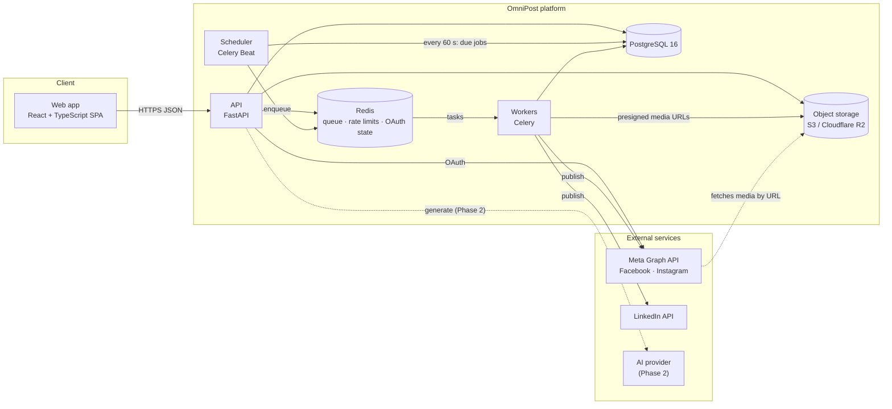

### Why this shape

| Choice | Reason |
|---|---|
| **Modular monolith, not microservices** | One team, one deployable, simple operations. Modules have clear boundaries so a part (e.g. publishing) can be split out later if load demands it |
| **Separate workers** | Publishing takes seconds, must run at a set time, and must not depend on a user's browser or a web request |
| **Database-driven scheduling** | Scheduled jobs live as rows in PostgreSQL, scanned every minute. Survives restarts; cancelling is a status update. Avoids Redis losing or re-delivering long-delayed tasks |
| **Object storage for media** | Meta downloads images by URL, so production media must be reachable through short-lived signed links |
| **SPA web app** | The product is entirely behind sign-in (no SEO need) and the in-memory token design fits a single-page app |

---

## 4. Component design

### 4.1 Web app (frontend)

| Aspect | Design |
|---|---|
| Stack | React 19, TypeScript, Vite, Tailwind CSS 4, shadcn/ui (Radix), TanStack Query, React Router |
| API types | Generated from the backend's OpenAPI schema (`openapi-typescript`), so the frontend can't drift from the API |
| Auth | Access token held **in memory only**; silent refresh via HttpOnly cookie; one shared refresh in flight at a time; CSRF header on cookie-authenticated calls |
| Data fetching | TanStack Query caching; polling every few seconds while a publish job is still running |
| Theming | Light / dark / match-device, applied instantly and saved to the user's account |
| Screens (Phase 1) | Login, Register, Home dashboard, Brands, Templates, Posts list, Post Studio, Post detail (approval + publish panels), Calendar, Connected accounts, Settings, Usage |

### 4.2 API (backend)

Layered inside each feature module:

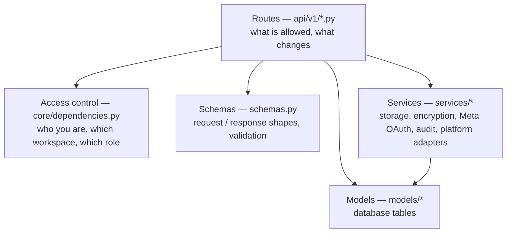

| Module | Responsibility |
|---|---|
| `auth` | Register, login, refresh, logout, current user, preferences |
| `workspaces` | Workspace settings, members, usage summary |
| `brands` | Brand profiles and logos |
| `templates` | Smart Templates catalogue |
| `posts` | Post CRUD, approval workflow, validation, scheduling, publishing, retry, job status |
| `media` | Upload, reorder, delete |
| `calendar` | Scheduled and published posts by date |
| `social_accounts` | Connect / list / disconnect platform accounts |
| `webhooks` | Meta deauthorization and data-deletion callbacks |
| `health` | Liveness and readiness probes |

**Cross-cutting middleware:** security headers, request ID on every response, Redis-backed rate limiting (login: 5 per 15 min per IP; workspace routes: 120 per minute), CORS restricted to the web app's origin.

### 4.3 Background processing

| Process | Runs | Job |
|---|---|---|
| **Celery Beat** (one instance) | Always | Every 60 s: find due publish jobs and enqueue them. Every 6 h: flag expiring social tokens. Hourly: move stuck jobs to *needs review* |
| **Celery workers** (1..N instances) | Always | Execute publish jobs, one platform account per job |

Worker settings chosen for safety: acknowledge a task only after it finishes (`acks_late`), re-queue if a worker dies mid-task, take one task at a time (`prefetch = 1`).

### 4.4 Platform adapters

One adapter per platform behind a common interface, selected by a factory:

```
publish(caption, media_urls, access_token, account_metadata, hashtags, cta) → {platform_post_id, url, published_at}
validate_text(text)    → [errors]
validate_media(urls)   → [errors]
```

| Platform | Phase 1 support | Mechanism |
|---|---|---|
| Facebook Page | Text, or text + 1 image | Single Graph API call |
| Instagram Business | 1 image | Create container → poll until ready → publish |
| LinkedIn | Text | Posts API (images in Phase 2) |
| Mock | Everything | Simulated, for demos and tests; disabled in production |

Adding a platform = one new adapter class + registration in the factory; the rest of the system is unchanged.

### 4.5 Storage

| Environment | Backend | Media access |
|---|---|---|
| Development | Local disk | Served by the API |
| Staging / production | S3-compatible bucket (Cloudflare R2 recommended), private | Presigned GET URLs valid 30 minutes, generated on demand |

The database stores **storage keys, never URLs**, so links can expire and rotate without touching data.

---

## 5. Data design

Full reference: [02_database.md](02_database.md). Summary:

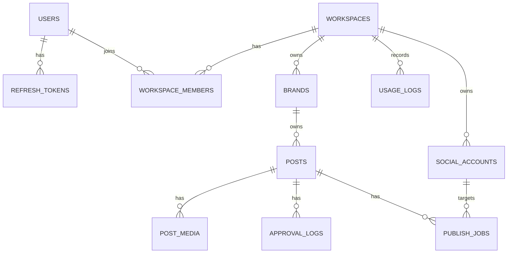

Plus two standalone tables: `caption_templates` (global Smart Templates) and `audit_events` (no foreign keys, so evidence survives any deletion).

### Data design principles

| Principle | How |
|---|---|
| **Tenant boundary = workspace** | Every customer-owned row rolls up to one workspace; every query goes through a membership check |
| **Status is explicit** | PostgreSQL enum types for post, job, role and action states |
| **Rules in the database too** | Check constraints (e.g. a scheduled post must have a time), unique constraints, cascades |
| **Append-only ledgers** | `approval_logs` and `audit_events` are never updated or deleted |
| **Flexible where it helps** | JSONB for brand guidelines, per-platform overrides, media metadata, filtered publish results |
| **Versioned schema** | Every change is an Alembic migration with upgrade and downgrade (currently 0001–0003) |
| **Soft vs hard delete** | Users, brands, accounts are deactivated; posts are deleted (audit trail remains) |

### Growth path

- **Indexes** already on all foreign keys and on status / schedule columns used by the dispatcher.
- **Partitioning** `audit_events` and `usage_logs` by month once they reach tens of millions of rows.
- **Read replica** for analytics and reporting in Phase 3, so heavy queries never slow down publishing.

---

## 6. Key flows

### 6.1 Sign-in and session refresh

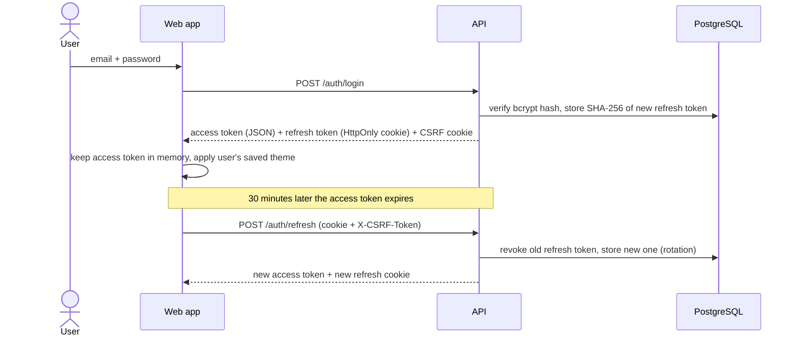

### 6.2 Create, approve and publish a post

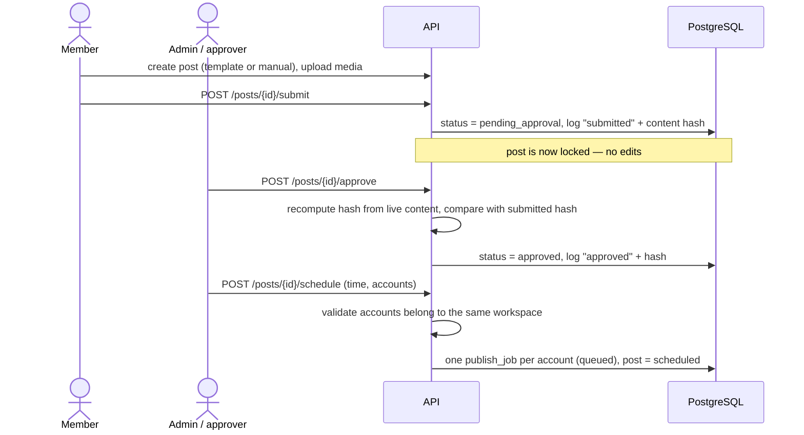

### 6.3 Scheduled publishing

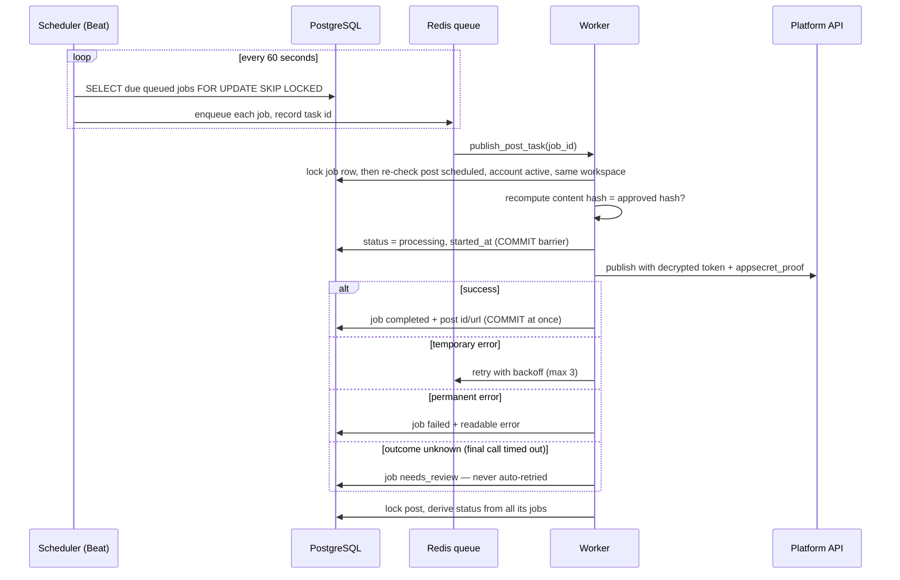

Post status after all jobs finish: all succeeded → `published`; some → `partially_published`; none → `failed`.

### 6.4 Connecting a Facebook / Instagram account

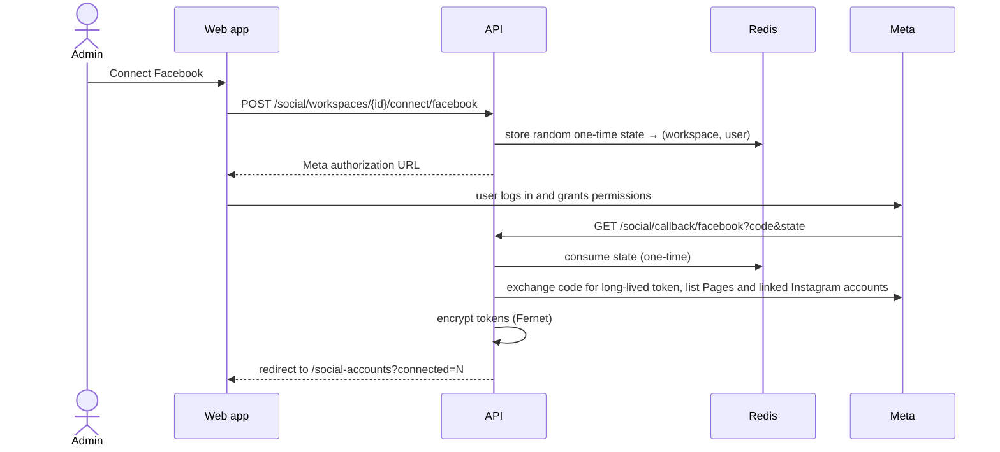

### 6.5 Media upload

1. Check extension against the allow-list (JPG, PNG, WEBP, GIF, MP4, MOV, WEBM).
2. Read in chunks, enforce size cap (25 MB image / 100 MB video); never trust `Content-Length`.
3. Check the file's real type from its bytes (magic bytes) matches its extension.
4. Re-encode images to strip EXIF (location, device data).
5. Store under a random key; save the key on `post_media`.
6. If the post was approved or scheduled, the change sends it back to draft (content changed).

### 6.6 Editing after approval

Any change to caption, hashtags, CTA, platform overrides or media on an `approved`, `scheduled` or `failed` post → status back to `draft`, queued jobs cancelled, `invalidated` entry in the approval log. The post must be approved again.

---

## 7. Security design

### 7.1 Authentication

| Control | Design |
|---|---|
| Passwords | bcrypt, cost 12 |
| Access token | JWT (PyJWT), 30 minutes, kept in browser memory only |
| Refresh token | Random 384-bit value, 14 days, HttpOnly + SameSite=strict cookie scoped to `/api/v1/auth`; only its SHA-256 hash is stored; rotated on every use |
| CSRF | Double-submit token on cookie-authenticated endpoints |
| Brute force | 5 login attempts per 15 minutes per IP |
| Proxy headers | `X-Forwarded-For` ignored unless explicitly trusted |

### 7.2 Authorization and tenancy

- Every route loads data through one of four access helpers (`get_workspace_member`, `get_brand_access`, `get_post_access`, `get_post_membership`). No ad-hoc permission queries.
- Non-members get **404, not 403**, so IDs can't be probed.
- Role rules: approve / reject / connect accounts = owner or admin; author ≠ approver unless the workspace allows self-approval.
- Any IDs sent by the client (e.g. target accounts) are re-validated against the workspace — and **checked again by the worker** before publishing.

### 7.3 Data protection

| Data | Protection |
|---|---|
| Platform access tokens | Fernet (AES-128-CBC + HMAC) at rest; never returned by any endpoint; never logged |
| Meta API calls | `appsecret_proof` on every call, so a leaked token alone is useless |
| Webhooks | HMAC-SHA256 signature verified |
| Uploaded images | EXIF stripped |
| Platform responses | Only post ID, URL and time stored — never raw payloads |
| Transport | HTTPS everywhere outside local development; TLS to database and Redis in production |
| Secrets | Environment variables / hosting secret store only; app refuses to start without them |

### 7.4 Production safety switch

With `ENVIRONMENT=production` the API refuses to start unless debug is off, cookies are secure and real secrets are set; it also hides the interactive API docs and disables mock accounts and demo seeding.

### 7.5 OWASP Top 10 coverage

| Risk | Mitigation |
|---|---|
| Broken access control | Central tenancy helpers, 404 on non-membership, role checks, worker re-checks |
| Cryptographic failures | bcrypt, Fernet, hashed refresh tokens, HTTPS |
| Injection | SQLAlchemy parameterised queries; Pydantic validation with length limits |
| Insecure design | Hash-bound approval, commit barrier, needs-review state |
| Security misconfiguration | Production safety switch, security headers, restricted CORS |
| Vulnerable components | Pinned dependencies; avoided `python-jose` and `passlib` |
| Authentication failures | Rotation, rate limits, HttpOnly cookies, CSRF |
| Integrity failures | Signed webhooks, OAuth state, content hash |
| Logging failures | Audit trail, request IDs |
| SSRF | Server only calls fixed platform API hosts; media URLs are generated by us |

---

## 8. Reliability and failure handling

**Design goals:** never post twice, never fail silently, survive restarts.

| Failure | What happens |
|---|---|
| API restarts | Stateless; nothing lost. Sessions continue via refresh cookie |
| Worker crashes mid-publish | Task re-queued (`acks_late`); job already `processing` → if under 15 min, skipped; if older, moved to `needs_review` |
| Scheduler down for a while | Due jobs stay `queued` in the database and are dispatched when it returns |
| Two schedulers running by mistake | `SKIP LOCKED` row locks prevent double dispatch |
| Duplicate task delivery | Worker locks the job row; a second delivery exits |
| Platform rate limit / 5xx / timeout before sending | Automatic retry with backoff, up to 3 times |
| Invalid token / permission / content rejected | Job `failed` with readable error; no retry |
| Final publish call times out | Job `needs_review`; a person checks the page and confirms before any retry |
| Content edited after approval | Worker hash check fails → job fails, nothing published |
| Token about to expire | Flagged 7 days ahead (`needs_reauth`); UI asks user to reconnect |
| Job stuck in processing > 1 hour | Hourly cleanup moves it to `needs_review` |

**Retry rules** (`POST /posts/{id}/retry`): only failed jobs retry in one click; `needs_review` requires explicit confirmation; completed jobs are never resent; content must still match the approval.

---

## 9. Scalability and performance

### 9.1 Capacity estimate (Phase 1 target)

| Metric | Assumption | Load |
|---|---|---|
| Workspaces | 500 | — |
| Posts published per day | 500 × 10 | ~5,000 jobs/day ≈ 3–4 per minute average, peaks of ~200 at round hours |
| Publish time per job | 2–10 s (Instagram polling longest) | 2 workers handle average load; 4–6 absorb peaks within a few minutes |
| API traffic | 50 concurrent users | Well within one API instance with a 10 + 20 connection pool |
| Storage | 5,000 images/day × ~1 MB | ~150 GB/month — object storage, not the database |

### 9.2 How it scales

| Part | Scaling approach |
|---|---|
| API | Stateless → run more instances behind the load balancer |
| Workers | Add instances; jobs are independent and row-locked |
| Scheduler | Exactly one instance (safe even if two run, due to row locks) |
| PostgreSQL | Vertical first; read replica for reporting; partition large log tables |
| Redis | Managed instance; holds only short-lived data (queue, counters, OAuth state) |
| Media | Object storage + CDN; Meta fetches directly from storage |

### 9.3 External limits we design around

| Platform | Limit | Handling |
|---|---|---|
| Instagram | 100 API posts per account per 24 h | Validation warns; failures reported per account |
| Meta tokens | ~60-day life | Expiry monitor + reconnect prompt |
| LinkedIn | Partner approval needed for posting APIs | Mock in Phase 1 until approved |

---

## 10. Deployment and environments

### 10.1 Environments

| Environment | Purpose | Infrastructure |
|---|---|---|
| **Local** | Development | Docker Compose: PostgreSQL, Redis, MinIO; API, worker, beat and web app run locally |
| **CI** | Automated checks on every push / PR | GitHub Actions with PostgreSQL 16 + Redis 7 services |
| **Staging / review** | Client review, demos, release testing | Managed PaaS (Railway or Render) + Cloudflare R2; `ENVIRONMENT=staging` |
| **Production** | Live customers | Same shape as staging, larger instances, backups and monitoring |

### 10.2 Production topology

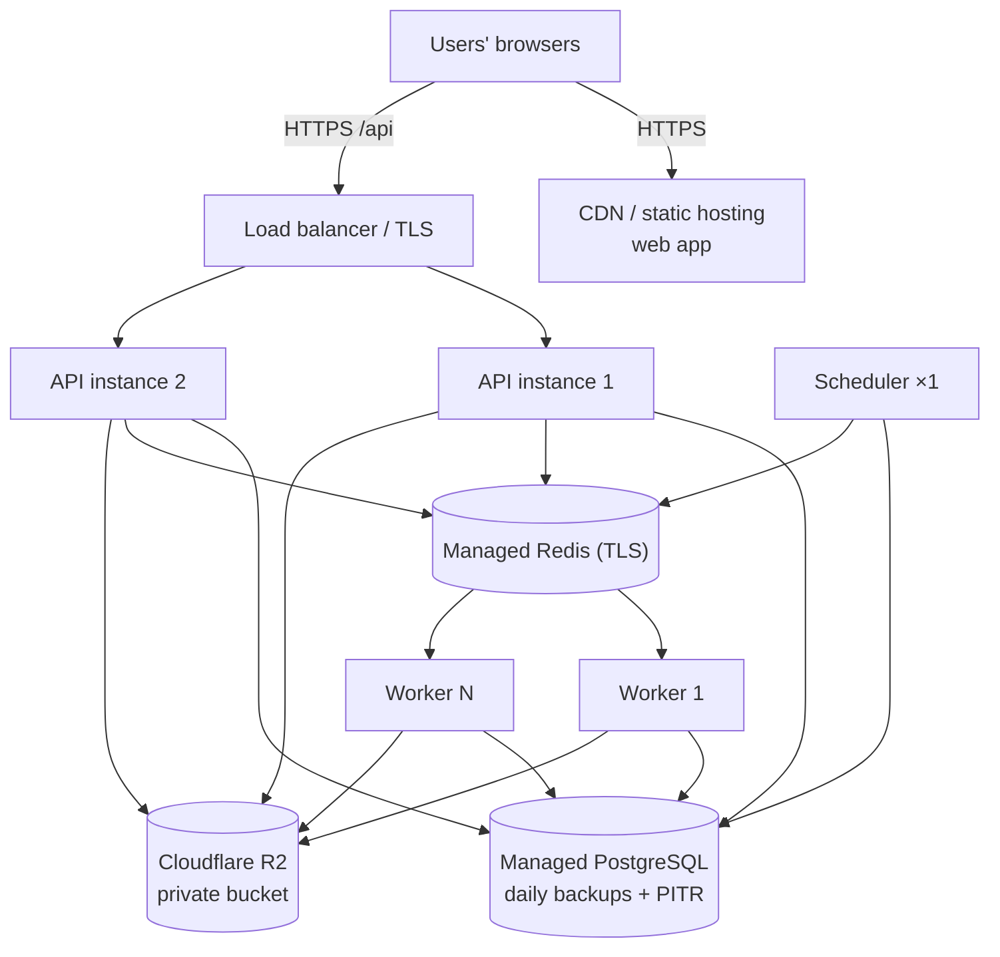

### 10.3 Release pipeline

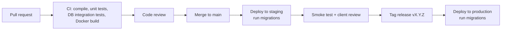

**Migrations** run before the new code takes traffic and are written to be backward compatible (add columns before using them, remove only after code no longer reads them), so a rollback of the code never breaks the database.

### 10.4 Configuration

All configuration through environment variables (see `backend/.env.example`). Secrets come from the hosting provider's secret store. `FERNET_KEY` must never change once accounts are connected.

---

## 11. Observability and operations

| Area | Now | Planned (before production) |
|---|---|---|
| Logs | Timestamped application logs; request ID on every response | Central log storage with search and retention |
| Health | `/health` (alive) and `/ready` (database + Redis reachable) | Platform health checks wired to restarts |
| Errors | Logged | Error tracking (e.g. Sentry) for API and workers |
| Metrics | — | Request latency, error rate, queue depth, job outcomes, publish delay |
| Alerts | — | Failed / needs-review jobs spike, queue backlog, scheduler stopped, DB storage, token-expiry wave |
| Audit | `audit_events` for every significant action | Admin view and export |
| Backups | — | Daily automated backups + point-in-time recovery; restore tested quarterly |

### Runbook essentials

| Symptom | First check |
|---|---|
| Posts stuck in `scheduled` | Is Beat running? Are workers running? |
| Many `failed` jobs on one platform | Platform status, token validity, recent API changes |
| `needs_review` job | Check the page on the platform; retry with confirmation only if not posted |
| Users logged out unexpectedly | Cookie settings, clock skew, `SECRET_KEY` change |

---

## 12. AI design (Phase 2)

AI is designed to plug into the existing workflow, **never bypass it**: AI output becomes a normal draft that goes through the same approval and publishing path.

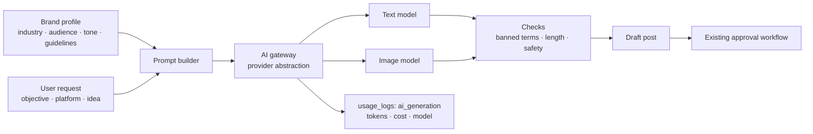

| Concern | Design |
|---|---|
| **Provider choice** | A small gateway interface so the provider can be changed without touching features |
| **Brand voice** | Prompts built from the brand profile and guidelines (tone, audience, banned terms) |
| **Platform fit** | Generate per platform within character limits; reuse existing validation |
| **Async execution** | Image generation and long requests run as worker tasks; the UI polls like publish jobs |
| **Cost control** | Every generation logged in `usage_logs` (`ai_generation` already reserved) with tokens and cost; per-workspace quotas; credits in Phase 3 billing |
| **Safety** | Output checks for banned terms and policy issues; nothing publishes without human approval |
| **Provenance** | Record that content was AI-assisted (model, time) for transparency and audit |
| **Privacy** | Send only what the prompt needs; no platform tokens or personal data to the AI provider |

---

## 13. Development approach

### 13.1 Principles

1. **Design the data first** — every feature starts with its tables, constraints and migration.
2. **Security by default** — tenancy check first line of every route; secrets never returned; production safety switch.
3. **Small, reviewable changes** — one feature or fix per pull request.
4. **Tests with every change** — happy path, wrong workspace (404), wrong role (403), wrong state (400/409).
5. **Typed contracts** — Pydantic on the backend, generated TypeScript types on the frontend.
6. **Document as we go** — `docs/` updated whenever behaviour, data or API changes.
7. **State limits honestly** — platform restrictions are validated in code and written in the known-limitations list.

### 13.2 Workflow

| Step | Practice |
|---|---|
| Plan | Feature mapped to requirement ID, data changes and endpoints |
| Branch | `feature/…`, `fix/…`, `docs/…` from `main` |
| Build | Backend: model → migration → schema → route → service → tests. Frontend: regenerate API types → screen → states (loading, empty, error) |
| Check | CI must be green: compile, unit tests, DB integration tests, Docker build |
| Review | Pull request with checklist (tenancy, roles, audit, migrations, docs, no secrets) |
| Release | Merge → staging → review → tag → production |

### 13.3 Testing strategy

| Level | What | Where |
|---|---|---|
| Unit | Security helpers, content hash, validation, adapter rules, worker guards | `backend/tests/` — no database |
| Integration | Real API + real migrations + worker task in-process against a throwaway database | `backend/tests/integration/` |
| End-to-end | Full user journey in the web app | Planned with Playwright before Phase 1 sign-off |
| Platform | Real Facebook / Instagram publish on test Pages | Manual check in staging with the client's Meta app |
| Security | Cross-workspace access, role abuse, upload abuse | Integration tests + review checklist |

### 13.4 Definition of done

Code reviewed · tests added and passing in CI · migration (if any) upgrades and downgrades · docs updated · works in staging · no new secrets or warnings.

---

## 14. Delivery plan

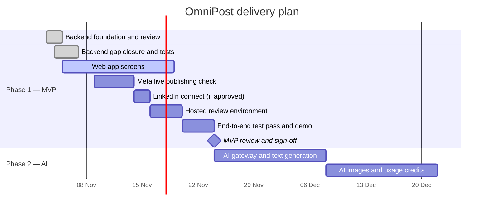

Dates after today are plans and will be confirmed at each checkpoint.

### Checkpoints with the client

| Checkpoint | Exit criteria |
|---|---|
| Web app ready for review | Every Phase 1 flow usable end to end on local / staging |
| Platform feasibility | Real Facebook + Instagram publish proven, or fallback documented |
| MVP sign-off | Stakeholder completes the full journey themselves; unapproved content can't be published; failures visible; data isolated |

---

## 15. Risks and mitigations

| Risk | Impact | Mitigation |
|---|---|---|
| Meta app review delays | Can't publish to real customer Pages | Mock mode for demos; start app review early; business verification in Week 1 |
| LinkedIn partner approval not granted | No LinkedIn publishing | Ship LinkedIn as a documented limitation; adapter already built |
| Platform API changes | Publishing breaks | Adapters isolated per platform; pinned API versions; monitoring of failure rates |
| Token expiry | Scheduled posts fail | 7-day early warning; reconnect flow |
| Double publishing | Brand damage | Commit barrier, row locks, needs-review state, retry rules |
| Cross-customer data leak | Severe trust and legal damage | Central tenancy helpers, 404 policy, worker re-checks, tests per endpoint |
| AI cost overrun (Phase 2) | Margin loss | Usage logging, quotas, credits |
| AI produces off-brand or unsafe content | Brand damage | Brand-aware prompts, output checks, mandatory human approval |
| Single-person knowledge | Slow onboarding | This document, technical guide, CI, review checklist |

---

## 16. Design decisions

| # | Decision | Alternatives considered | Why |
|---|---|---|---|
| D1 | Modular monolith | Microservices | Small team, simpler ops; modules can be extracted later |
| D2 | FastAPI + Celery (Python) | NestJS + BullMQ | Built and reviewed; same architecture principles; strong AI ecosystem for Phase 2 |
| D3 | PostgreSQL | MySQL, MongoDB | Row locks (`SKIP LOCKED`), JSONB, enums, check constraints |
| D4 | DB-scanned scheduling every 60 s | Celery ETA tasks | Survives restarts, no re-delivery, cancel = status update |
| D5 | One publish job per account | One job per post | Independent retries, honest partial success |
| D6 | Approval bound to content hash | Approval flag only | Provable "who approved what"; tampering detected before publishing |
| D7 | Refresh token in HttpOnly cookie, access token in memory | Tokens in localStorage | Script injection can't steal the long-lived token |
| D8 | Self-approval per workspace (on for one person, off when second member joins) | Always forbid / always allow | Supports both solo businesses and agencies |
| D9 | React SPA (Vite) | Next.js | Fully behind login, no SEO need; fits in-memory auth |
| D10 | Managed PaaS + Cloudflare R2 | Kubernetes, AWS from scratch | Fast to set up, low ops; R2 has free egress and is S3-compatible |
| D11 | Audit table without foreign keys | Regular FK table | Evidence survives deletion of users, workspaces, posts |
| D12 | Theme preference stored on user | Browser storage only | Same experience on every device and every login |

---

## 17. Glossary

| Term | Meaning |
|---|---|
| **Workspace** | A customer account (company or agency); the boundary between customers |
| **Brand** | A company or client whose social media is managed in a workspace |
| **Smart Template** | A ready-made post with placeholders, used instead of AI in Phase 1 |
| **Content hash** | A SHA-256 fingerprint of everything that will be published; used to prove what was approved |
| **Publish job** | One attempt to publish one post to one social account |
| **Needs review** | A job whose outcome is unknown; a person must check the platform before retrying |
| **Beat** | The Celery scheduler that dispatches due jobs every minute |
| **Worker** | A background process that executes publish jobs |
| **Mock account** | A simulated social account for demos and tests |
| **appsecret_proof** | An HMAC Meta requires so a token can't be used without our app secret |
| **Presigned URL** | A temporary link to a private file in object storage |
